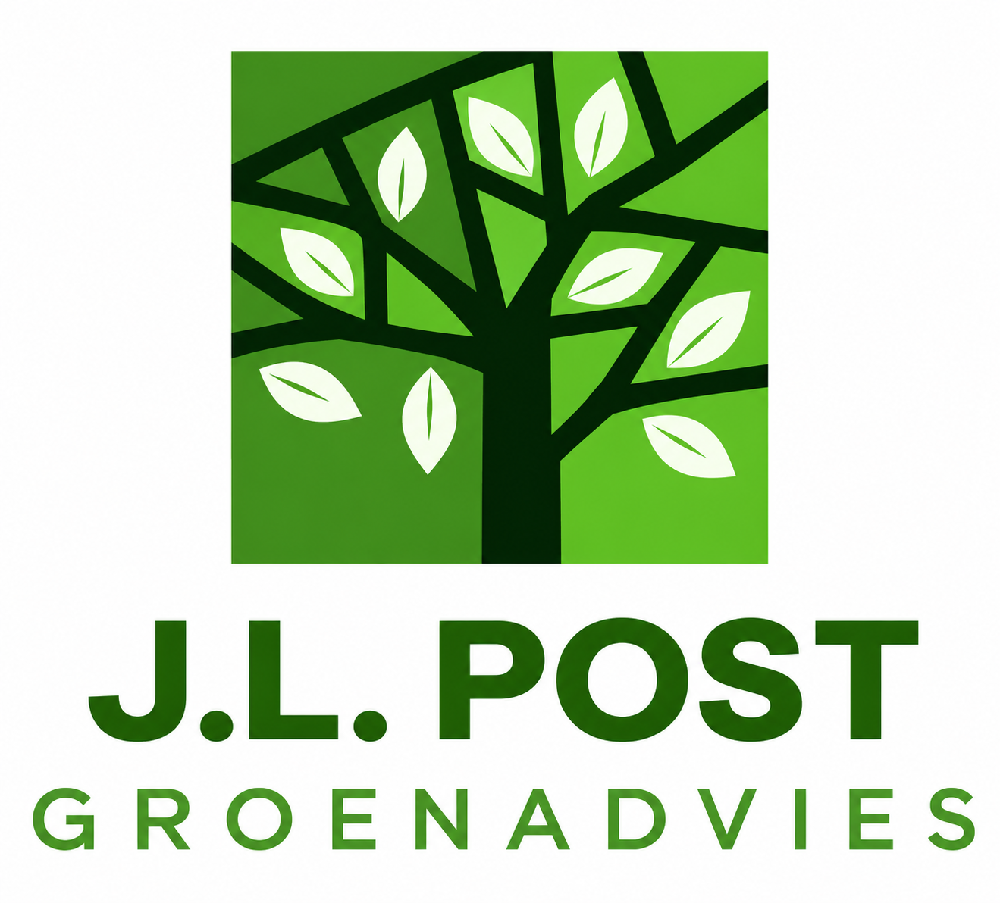

<h1 align="center">Mainframe</h1>

<em>De digitale collega van J.L. Post Groenadvies</em>

---

## Starten
Klik rechtsboven op het **oranje sterretje** (Claude Code) en typ wat je wilt. Typ **/** om direct een skill te kiezen.

| Snelkoppeling | Wat het doet | Voorbeeld |
|---|---|---|
| `/offerte` | Offerte voor advieswerk | */offerte werkplan bomen gemeente X, uitvraag in bronnen/X* |
| `/kostenraming` | Raming volgens SSK | */kostenraming op basis van bronnen/Y/hoeveelheden.xlsx* |
| `/werkplan-bomen` | Werkplan / bomenbeschermingsplan | */werkplan-bomen voor project Z* |
| `/plantselectietabel` | Soortentabel met ecologische data | */plantselectietabel verrijk bronnen/Gouda met strooizouttolerantie* |
| `/beplantingsplan` | Van locatie tot plantlijst | */beplantingsplan voor plantvak bij school* |
| `/geheugen-bijwerken` | Iets blijvend vastleggen | */geheugen-bijwerken offertes voortaan 60 dagen geldig* |
| `/nieuwe-skill` | Nieuwe vaste werkwijze toevoegen | */nieuwe-skill beantwoorden van uitvragen* |

Zeg **"opslaan"** om alles naar je privé GitHub te sturen.

## Mappen
**context/** bedrijfskennis · **geheugen/** besluiten en lessen · **bronnen/** jouw documenten (lokaal) · **output/** resultaten (lokaal) · **huisstijl/** logo en kleuren

Volledige handleiding: [LEESMIJ.md](LEESMIJ.md)
